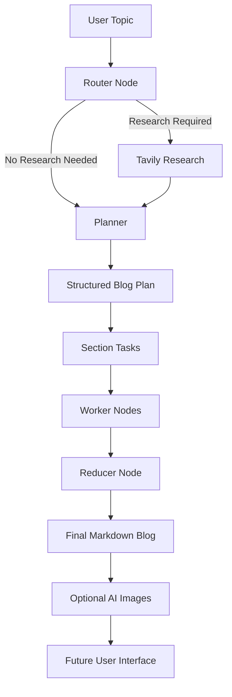

# langgraph-Ai-blog-writer

# 🤖 LangGraph AI Blog Writer

### A Planning-Based AI Agent for Automated Blog Generation

An AI-powered blog writing agent built around **LangGraph and Large Language Models (LLMs)**. Instead of generating an entire blog in a single step, the system follows a structured planning-and-execution workflow to produce organized, section-based content.

The project explores how AI agents can combine task planning, conditional routing, parallel execution, research, and content generation into a single workflow.

> **Project Status:** Initial project documentation. Features will be marked as implemented as development progresses.

---

##  Table of Contents

- [Overview](#-overview)
- [Why This Project?](#-why-this-project)
- [Key Features](#-key-features)
- [How It Works](#-how-it-works)
- [System Architecture](#-system-architecture)
- [Technology Stack](#-technology-stack)
- [Development Roadmap](#-development-roadmap)
- [Project Structure](#-project-structure)
- [Installation](#-installation)
- [Environment Variables](#-environment-variables)
- [Example Use Case](#-example-use-case)
- [Learning Outcomes](#-learning-outcomes)
- [Future Improvements](#-future-improvements)
- [Contributing](#-contributing)
- [License](#-license)

---

## 🎯 Overview

Traditional LLM-based content generation often attempts to complete a complex writing task in one response. This can lead to inconsistent structure, limited research, and weaker control over individual sections.

This project explores a more structured approach using a **planning-based AI agent**.

Given a topic, the agent can be designed to:

1. Analyze the user's topic.
2. Determine whether external research is needed.
3. Generate a structured blog plan.
4. Divide the blog into individual section-writing tasks.
5. Execute section-writing tasks through worker nodes.
6. Combine the generated sections into a final Markdown document.
7. Extend the workflow with research, AI-generated images, and a user interface.

The goal is to understand and implement agentic workflows using LangGraph rather than relying on a single LLM call.

## 💡 Why This Project?

A complex task is often easier to manage when it is broken into smaller, well-defined steps.

A planning-based agent separates **decision-making, task execution, and final output generation**.

This approach provides a foundation for learning:

- Agentic AI and workflow orchestration
- LangGraph nodes, edges, and conditional routing
- Planner-worker-reducer architecture
- Structured outputs using Pydantic
- Research-assisted content generation
- Parallel task execution
- Modular and maintainable AI applications

## ✨ Key Features

The following features describe the project scope; implementation status will depend on the development stage.

- **Intelligent Planning:** Create a structured outline before writing.
- **Conditional Routing:** Decide whether a topic requires external research.
- **Task Decomposition:** Convert a blog outline into section-level tasks.
- **Worker-Based Generation:** Generate individual sections through worker nodes.
- **Content Reduction:** Merge completed sections into a coherent Markdown blog.
- **Research Integration:** Use Tavily for web research in the research-enabled stage.
- **Structured Data:** Define plans and task objects using Pydantic.
- **AI Image Generation:** Extend the blog with images using Google's Gemini models.
- **User Interface:** Add a graphical interface in a later development stage.

## ⚙️ How It Works

### Step 1: User Input

The user provides a blog topic, such as:

`How Transformer Architecture Works`

### Step 2: Router Node

The router determines whether the topic needs external research.

- If research is unnecessary, the workflow can continue directly to planning.
- If research is needed, the workflow can retrieve relevant information using Tavily.

### Step 3: Research

In the research-enabled version, relevant information is gathered and made available to the planner and worker nodes.

### Step 4: Planner / Orchestrator

The planner converts the topic and available context into a structured plan containing:

- Blog title
- Section titles
- Task IDs
- Instructions or descriptions for each section

Pydantic can be used to validate the plan's structure.

### Step 5: Worker Nodes

Individual workers generate content for their assigned sections. This modular approach allows different sections to be processed independently and supports parallel execution.

### Step 6: Reducer Node

The reducer combines the generated sections, organizes the content, and produces the final Markdown blog.

### Step 7: Optional Enhancements

Advanced stages can add AI-generated images and a graphical user interface.

## 🏗️ System Architecture



**Core architecture:** Router → Planner → Workers → Reducer.

Research and image generation are optional extensions of the workflow.

## 🧰 Technology Stack

| Technology | Purpose |
|---|---|
| Python | Core programming language |
| LangGraph | AI workflow orchestration |
| LangChain | LLM integration and related components |
| Large Language Models | Planning and content generation |
| Pydantic | Structured data models and validation |
| Tavily | Web research in the research-enabled stage |
| Google Gemini | Image generation in the image-enabled stage |
| Markdown | Final blog output format |

## 🛣️ Development Roadmap

### Phase 1 — Basic Blog Writing Agent

- Set up the Python project.
- Define structured blog plans and task objects.
- Implement the planner.
- Create section-writing worker nodes.
- Implement the reducer.
- Generate a complete Markdown blog.

### Phase 2 — Research-Enabled Agent

- Add conditional routing for research decisions.
- Integrate Tavily.
- Collect relevant information for the topic.
- Make research context available to the planner and workers.
- Improve research-aware content generation.

### Phase 3 — AI Image Generation

- Integrate Google's Gemini image-generation capabilities.
- Generate relevant images for blog content.
- Incorporate images into the final blog output.

### Phase 4 — User Interface

- Build a graphical interface for entering blog topics.
- Display the generated blog.
- Improve usability and output presentation.

### Phase 5 — Advanced Improvements

- Add error handling and API failure recovery.
- Validate structured outputs.
- Add logging and workflow tracing.
- Evaluate output quality.
- Improve prompts and section consistency.
- Add automated tests and deployment support.

*These phases represent the intended development roadmap, not a claim that every feature is already implemented.*

## 📂 Project Structure

The planned project structure is:

```text
langgraph-ai-blog-writer/
│
├── app.py
├── requirements.txt
├── .env.example
├── .gitignore
├── README.md
│
├── src/
│   ├── __init__.py
│   ├── graph.py
│   ├── nodes.py
│   ├── prompts.py
│   └── schemas.py
│
├── outputs/
│   └── .gitkeep
│
└── assets/
    └── .gitkeep
```

The structure may evolve as the application is implemented.

## 🚀 Installation

### Prerequisites

- Python 3.10 or a compatible Python version
- Git
- A code editor such as VS Code
- API credentials for the services used in the selected development stage

### 1. Clone the Repository

```bash
git clone https://github.com/langgraph-ai-blog-writer.git
cd langgraph-ai-blog-writer
```

### 2. Create a Virtual Environment

**Windows:**

```powershell
python -m venv .venv
.\.venv\Scripts\Activate.ps1
```

If PowerShell activation is blocked, use Command Prompt:

```bat
.venv\Scripts\activate.bat
```

### 3. Install Dependencies

After `requirements.txt` has been created and populated:

```bash
pip install -r requirements.txt
```

### 4. Configure Environment Variables

Create a local `.env` file based on `.env.example` and add the credentials required by the implemented features.

### 5. Run the Application

Once `app.py` and the application workflow are implemented:

```bash
python app.py
```

*The commands above describe the intended setup. They will work as a complete application setup after the corresponding files and code have been added.*

## 🔐 Environment Variables

Depending on the integrations implemented, the application may require credentials such as:

```env
# Add the variables required by your selected LLM provider
LLM_API_KEY=

# Required for the research-enabled stage
TAVILY_API_KEY=

# Required for Gemini image generation
GEMINI_API_KEY=
```

Use the exact variable names expected by your implementation.

**Security:** Never commit your actual API keys, `.env` file, or other secrets to GitHub. Add `.env` to `.gitignore` before uploading code.

## 🧪 Example Use Case

**Input topic:**

`The Future of Agentic AI`

**Expected workflow:**

1. The router decides whether additional research is required.
2. The planner creates a title and section-level tasks.
3. Workers generate content for the assigned sections.
4. The reducer combines the sections.
5. The application returns a structured Markdown blog.

The exact generated output will depend on the prompts, model, research context, and implementation.

## 📚 Learning Outcomes

By developing this project, you can gain practical experience with:

- Designing stateful AI workflows
- Understanding LangGraph's graph-based execution model
- Implementing conditional routing
- Building planner-worker-reducer systems
- Creating structured LLM outputs with Pydantic
- Integrating external research tools
- Managing API credentials securely
- Organizing a modular Python project
- Preparing an AI application for testing and deployment

## 🔮 Future Improvements

Potential improvements include:

- Source links and research attribution
- Improved factual consistency
- Retry logic and graceful error handling
- Human review before final publication
- Blog export to HTML or PDF
- Persistent workflow state
- Unit and integration tests
- Docker-based deployment
- Automated evaluation of generated content
- A polished web interface

## 🤝 Contributing

Contributions, suggestions, and improvements are welcome.

1. Fork the repository.
2. Create a feature branch.
3. Implement and test your changes.
4. Open a pull request describing the improvement.

## 📄 License

A license has not yet been selected. Add an appropriate license file before distributing the project under an open-source license.

---

### 👨‍💻 Author

**AlokAI99**

GitHub: [@AlokAI99](https://github.com/AlokAI99)

Interested in AI Engineering, LLM applications, Agentic AI, and building practical AI projects.

---

⭐ If you find this project useful, consider starring the repository as it develops.
